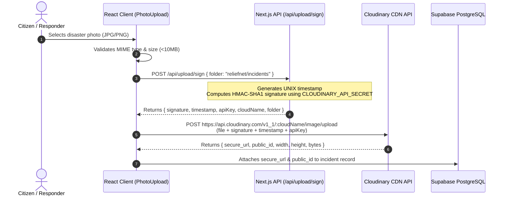

# Cloudinary Media Pipeline & Security Architecture
## ReliefNet — Disaster Response Intelligence Platform

Photographic verification is a cornerstone of effective disaster triage. During floods, cyclones, or collapsed infrastructure events, coordinators must assess the severity of physical damage before deploying scarce high-clearance vehicles or rescue boats.

ReliefNet integrates Cloudinary to deliver an enterprise-grade, secure, and performant media ingestion pipeline.

---

## 1. Why Cloudinary is Essential for Disaster Response

1. **Bandwidth Optimization in Crisis Zones:** Responders in remote or disaster-hit zones often operate on degraded 2G/3G mobile networks. Cloudinary automatically delivers compressed, next-gen WebP/AVIF formats with dynamic quality (`q_auto, f_auto`), drastically reducing page weight and load latency.
2. **Offloading Server Compute:** Encoding high-resolution smartphone images on Next.js serverless functions would cause timeouts, memory exhaustion, and latency spikes. Cloudinary performs processing on edge CDN infrastructure.
3. **Resilient CDN Edge Caching:** Images uploaded once are immediately propagated across Cloudinary's worldwide CDN edge nodes, ensuring instant loading for multi-agency relief teams.

---

## 2. Server-Signed Upload Workflow (Zero Secret Leakage)

To prevent exposure of the master `CLOUDINARY_API_SECRET`, ReliefNet implements a **two-phase signed upload protocol**:



---

## 3. Security Protections & Best Practices

- **Zero Exposure of API Secret:** `CLOUDINARY_API_SECRET` is kept strictly server-side and never prefixed with `NEXT_PUBLIC_`.
- **Timestamped Signatures:** Every generated signature includes an active UNIX timestamp (`Math.round(Date.now() / 1000)`) to mitigate replay attacks.
- **Directory Jailing:** Upload signatures enforce the `reliefnet/incidents` folder parameter. Attackers cannot upload files into other arbitrary Cloudinary paths.
- **Strict File Type Verification:** Only verified image formats (`image/jpeg`, `image/png`, `image/webp`, `image/gif`) are accepted. Executables or script files are blocked at the client and server layers.
- **Maximum File Limit:** Enforces a 10MB limit per file to preserve mobile responder bandwidth.

---

## 4. Configuration Environment Keys

To configure live Cloudinary uploads, supply the following keys in `.env.local`:

```ini
# Client-side cloud identifier for asset URL generation
NEXT_PUBLIC_CLOUDINARY_CLOUD_NAME="your-cloud-name"

# Server-side authentication keys (NEVER expose to client)
CLOUDINARY_API_KEY="your-api-key"
CLOUDINARY_API_SECRET="your-api-secret"

# Optional restricted upload preset
CLOUDINARY_UPLOAD_PRESET="reliefnet-incidents"
```

When keys are not set, ReliefNet's `PhotoUpload` component automatically catches missing credentials gracefully and informs the user while preserving the rest of the form workflow.
