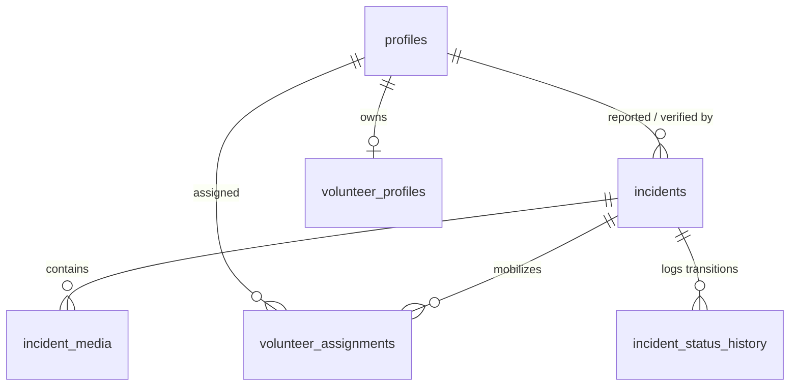

# Database Schema & Data Integrity Design
## ReliefNet — Disaster Response Intelligence Platform

ReliefNet uses a normalized relational PostgreSQL schema managed through Supabase with strict referential integrity, indexes, and Row Level Security (RLS) policies.

---

## 1. Relational Entity Overview

---

## 2. Table Specifications

### `profiles`
Stores user identity metadata linked directly to Supabase Auth (`auth.users`).
| Column | Type | Constraints | Description |
| :--- | :--- | :--- | :--- |
| `id` | `UUID` | PK, REFERENCES `auth.users(id)` ON DELETE CASCADE | Matches Supabase Auth user ID |
| `email` | `TEXT` | NOT NULL | User email address |
| `full_name` | `TEXT` | NULLABLE | Display name / responder call-sign |
| `role` | `user_role` | NOT NULL DEFAULT `'volunteer'` | Enum: `volunteer`, `coordinator`, `admin` |
| `created_at` | `TIMESTAMPTZ` | NOT NULL DEFAULT `now()` | Registration timestamp |
| `updated_at` | `TIMESTAMPTZ` | NOT NULL DEFAULT `now()` | Auto-updated via trigger |

### `incidents`
Core crisis incident records reported by the public or coordinators.
| Column | Type | Constraints | Description |
| :--- | :--- | :--- | :--- |
| `id` | `UUID` | PK, DEFAULT `uuid_generate_v4()` | Unique internal identifier |
| `reference_code` | `TEXT` | NOT NULL UNIQUE | Human-readable public code (e.g. `RN-2026-AB12C`) |
| `title` | `TEXT` | NOT NULL (5–120 chars) | Short emergency summary |
| `description` | `TEXT` | NOT NULL (min 20 chars) | Full field situation report |
| `category` | `incident_category` | NOT NULL | Enum: `flood`, `cyclone`, `fire`, `infrastructure_damage`, `medical_assistance`, `food_water`, `shelter`, `other` |
| `severity` | `incident_severity` | NOT NULL | Enum: `low`, `moderate`, `high`, `critical` |
| `status` | `incident_status` | NOT NULL DEFAULT `'unverified'` | Enum: `unverified`, `verified`, `in_progress`, `resolved`, `rejected` |
| `location_name` | `TEXT` | NOT NULL | Descriptive landmark or ward |
| `latitude` | `DOUBLE PRECISION` | CHECK (-90 to 90) | Optional geospatial latitude |
| `longitude` | `DOUBLE PRECISION` | CHECK (-180 to 180) | Optional geospatial longitude |
| `people_affected`| `INTEGER` | CHECK (>= 0) | Estimated affected count |
| `assistance_requested` | `TEXT` | NULLABLE | Relief supplies / team requested |
| `reported_by` | `UUID` | REFERENCES `profiles(id)` | User who filed the report (null if anonymous) |
| `verified_by` | `UUID` | REFERENCES `profiles(id)` | Coordinator who verified |
| `verified_at` | `TIMESTAMPTZ` | NULLABLE | Timestamp of coordinator approval |
| `is_demo` | `BOOLEAN` | NOT NULL DEFAULT `false` | Distinguishes demo from production |
| `created_at` | `TIMESTAMPTZ` | NOT NULL DEFAULT `now()` | Creation timestamp |
| `updated_at` | `TIMESTAMPTZ` | NOT NULL DEFAULT `now()` | Auto-updated via trigger |

### `incident_media`
Tracks photos attached to incidents hosted securely on Cloudinary.
| Column | Type | Constraints | Description |
| :--- | :--- | :--- | :--- |
| `id` | `UUID` | PK, DEFAULT `uuid_generate_v4()` | Unique ID |
| `incident_id` | `UUID` | NOT NULL, REFERENCES `incidents(id)` ON DELETE CASCADE | Associated incident |
| `cloudinary_public_id` | `TEXT` | NOT NULL | Cloudinary asset identifier |
| `cloudinary_url` | `TEXT` | NOT NULL | Cloudinary HTTPS CDN delivery URL |
| `resource_type` | `TEXT` | NOT NULL DEFAULT `'image'` | Media type |
| `format` | `TEXT` | NULLABLE | e.g. `jpg`, `png`, `webp` |
| `width` | `INTEGER` | NULLABLE | Pixel width |
| `height` | `INTEGER` | NULLABLE | Pixel height |
| `bytes` | `INTEGER` | NULLABLE | File size in bytes |
| `uploaded_by` | `UUID` | REFERENCES `profiles(id)` | Uploader ID |
| `created_at` | `TIMESTAMPTZ` | NOT NULL DEFAULT `now()` | Upload timestamp |

### `volunteer_profiles`
Skills and availability profiles for registered relief responders.
| Column | Type | Constraints | Description |
| :--- | :--- | :--- | :--- |
| `id` | `UUID` | PK, DEFAULT `uuid_generate_v4()` | Unique ID |
| `user_id` | `UUID` | NOT NULL UNIQUE, REFERENCES `profiles(id)` ON DELETE CASCADE | One-to-one user mapping |
| `skills` | `TEXT[]` | NOT NULL DEFAULT `'{}'` | Array of capabilities |
| `availability` | `TEXT` | NOT NULL | e.g. "Weekends", "Night shifts" |
| `organization` | `TEXT` | NULLABLE | e.g. Red Cross, Civil Defence |
| `is_active` | `BOOLEAN` | NOT NULL DEFAULT `true` | Active status |

### `volunteer_assignments`
Tracks dispatch of volunteers to verified incidents. Prevents duplicate deployments.
| Column | Type | Constraints | Description |
| :--- | :--- | :--- | :--- |
| `id` | `UUID` | PK, DEFAULT `uuid_generate_v4()` | Unique ID |
| `incident_id` | `UUID` | NOT NULL, REFERENCES `incidents(id)` ON DELETE CASCADE | Assigned incident |
| `volunteer_id`| `UUID` | NOT NULL, REFERENCES `profiles(id)` ON DELETE CASCADE | Assigned volunteer |
| `assigned_by` | `UUID` | REFERENCES `profiles(id)` | Coordinator who assigned |
| `status` | `assignment_status` | NOT NULL DEFAULT `'pending'` | Enum: `pending`, `accepted`, `in_progress`, `completed`, `cancelled` |
| `notes` | `TEXT` | NULLABLE | Field mission instructions |
| *Constraint* | `UNIQUE(incident_id, volunteer_id)` | Prevents duplicate assignments |

### `incident_status_history`
Immutable audit log recording every lifecycle status transition.
| Column | Type | Constraints | Description |
| :--- | :--- | :--- | :--- |
| `id` | `UUID` | PK, DEFAULT `uuid_generate_v4()` | Unique ID |
| `incident_id` | `UUID` | NOT NULL, REFERENCES `incidents(id)` ON DELETE CASCADE | Associated incident |
| `previous_status` | `incident_status` | NULLABLE | Previous state |
| `new_status` | `incident_status` | NOT NULL | Newly transitioned state |
| `changed_by` | `UUID` | REFERENCES `profiles(id)` | User who authorized change |
| `notes` | `TEXT` | NULLABLE | Rationale / field remarks |
| `created_at` | `TIMESTAMPTZ` | NOT NULL DEFAULT `now()` | Transition timestamp |

---

## 3. Database Triggers & Automations

1. **Auto Profile Provisioning (`handle_new_user`):** Automatically creates a matching row in `public.profiles` upon `auth.users` registration.
2. **Status Audit Logging (`log_incident_status_change`):** Fires upon `UPDATE` on `incidents`. If `OLD.status != NEW.status`, an audit record is created in `incident_status_history`.
3. **Timestamp Update (`update_updated_at_column`):** Automatically sets `updated_at = now()` before updates on `incidents`, `profiles`, and `volunteer_profiles`.
